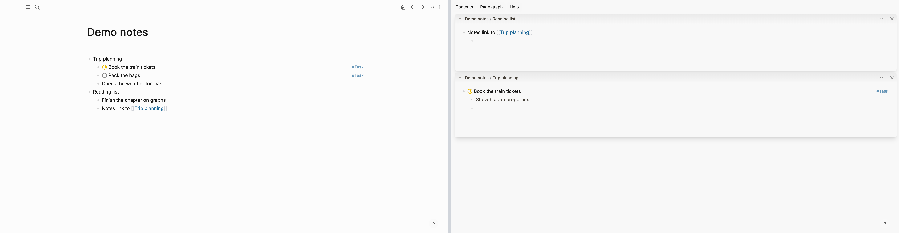

# Sidebar Window

A Logseq plugin that opens a second Logseq window showing only the right sidebar, so you can put the sidebar on another screen. The two windows behave like one Logseq whose sidebar sits on the second screen. The plugin writes nothing to your graph.



## What it does
- Everything that would open in the right sidebar of the main window opens in the Sidebar Window instead: shift-click on a bullet, page link, tag or block reference; "Open in sidebar" in the context menu; Shift+Enter on a selected block or a search result; the `open_in_right_sidebar` call of other plugins.
- A click on a bullet, page link, tag or block reference in the Sidebar Window navigates the main window. Clicking text (edit in place), shift-click (another card), folding and closing cards, and the Contents / Page graph / Help tabs stay in the Sidebar Window.
- In the Sidebar Window the left menu, header and main area are hidden; the right sidebar fills the window (works down to 400 px wide).

## How to open it
- Command palette: **Sidebar Window: Open**.
- Or the **Window** button in the top row of the right sidebar.

If the window is already open, the command brings it to the front (when the OS allows) and never opens a second one.

## Install
From the Logseq Marketplace (once listed), or manually: download the zip from the latest release, unzip it, turn on Developer mode (Settings > Advanced), then Plugins > "Load unpacked plugin" and choose the unzipped folder.

## Requirements and honest limits
- Logseq desktop 2.0.2 or newer, **DB graphs only** (file graphs are not supported).
- Tested on macOS only. Windows and Linux are untested.
- The plugin runs with `effect: true` (same origin as Logseq) and uses Logseq internals that are not a public API (`apis.doAction`, the elements `#left-container` and `#right-sidebar`, the sidebar state). A Logseq update can break it. If an internal is missing, the plugin shows a message and leaves the window as it is.
- Do not type in the same block in both windows at once: Logseq loses keystrokes (it does so for any two windows on one graph).
- Window size and position cannot be set safely through Logseq, so the operating system decides.
- Two open windows use a little more CPU, because each runs the plugins.

## When a window closes
- Close the Sidebar Window: the main window is plain Logseq again within about 2 seconds.
- Close or reload the main window: the Sidebar Window waits 15 seconds, then returns to the normal Logseq layout. If the same main window answers again later, the Sidebar Window goes back to the sidebar-only layout by itself.
- A main window that is covered or minimised is not treated as closed: the Sidebar Window keeps its layout as long as the main window still answers (version 0.1.1; covered by simulated tests, not yet by a long real-world run).
- After a Logseq restart the Sidebar Window is not restored; open it again.

## Development
```
npm ci
npm test
npm run build
```
Then load this folder as an unpacked plugin. License: MIT.
